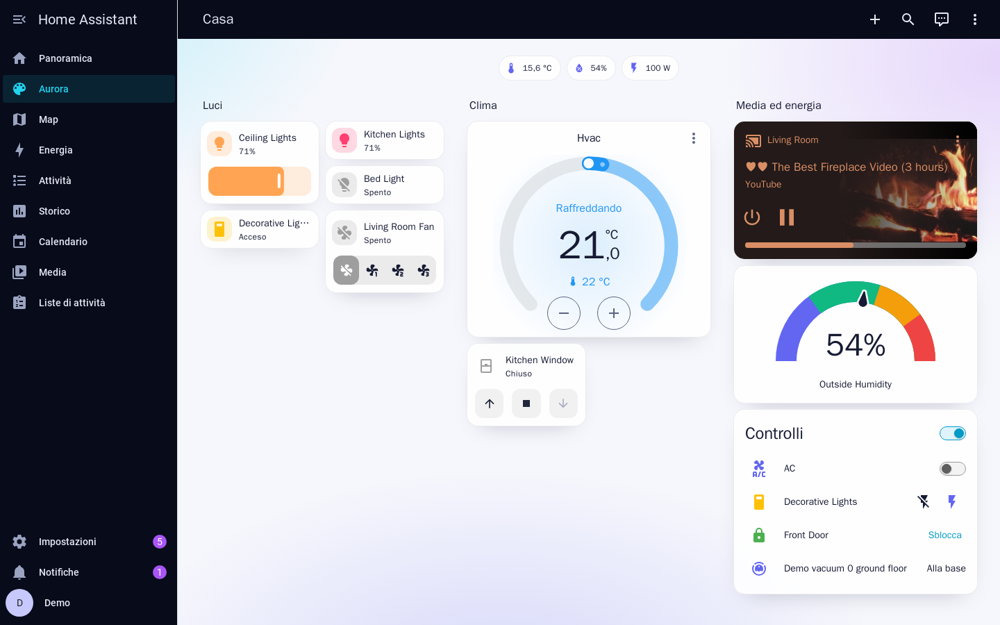
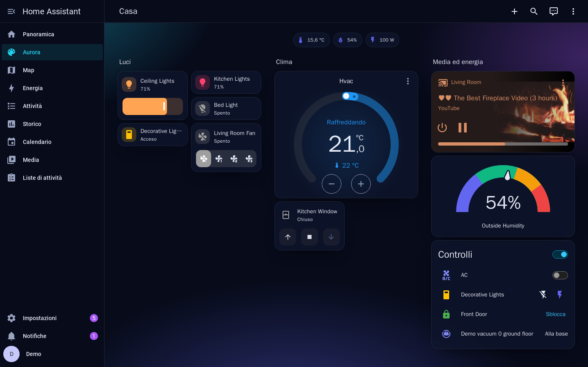
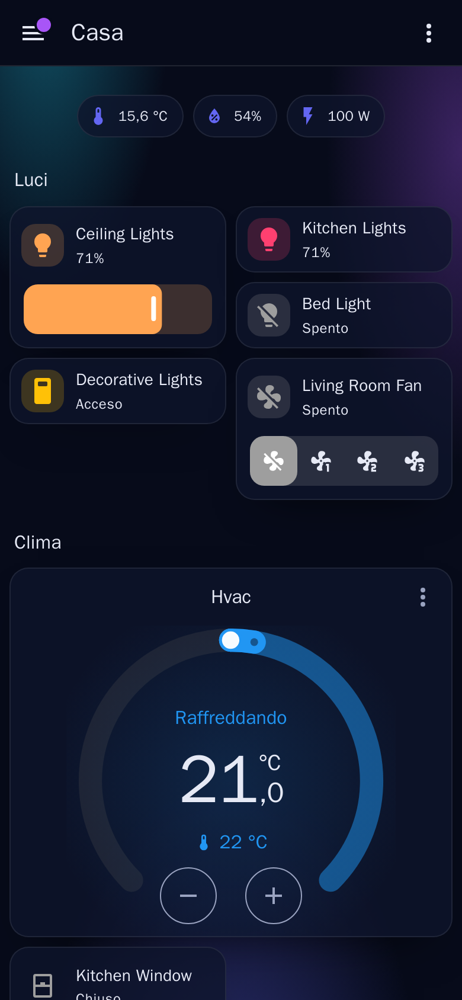

# MMOUi Personal Theme

Tema personale per **Home Assistant** (testato su 2026.10), con lo stesso stile dei temi di login per Keycloak e Grafana: palette ciano → indaco → viola, sidebar e barra superiore blu notte, aurore sfumate dietro le plance e card arrotondate.



- Supporta modalità chiara e scura (`modes`): sidebar e barra superiore restano sempre scure, il contenuto segue la scelta del profilo (*Automatico* segue il sistema).

  

- Su mobile:

  

- Card semitrasparenti con bordo sottile, raggio 16px, badge a pillola; interruttori, slider, checkbox e icone degli stati nei colori della palette; grafici con una palette coordinata; errori/avvisi con gli stessi colori degli alert del login.
- Solo variabili del tema: non servono `card-mod` né altre risorse.

## Installazione

### Da HACS

1. HACS → menu ⋮ → **Repository personalizzati** → `https://github.com/mattiaouiapp/HomeAssistant_HACS_Tema`, categoria **Tema**.
2. Cerca **MMOUi Personal Theme** e scaricalo.
3. Se non l'hai già, aggiungi a `configuration.yaml` e riavvia Home Assistant:

   ```yaml
   frontend:
     themes: !include_dir_merge_named themes
   ```

   Se c'era già, basta l'azione `frontend.reload_themes`.

Gli aggiornamenti arrivano da HACS come per le integrazioni; dopo l'aggiornamento lancia `frontend.reload_themes`.

### Manuale

Copia `themes/mmoui_personal_theme.yaml` in `<config>/themes/`, poi come al punto 3.

### Attivazione

- **Per il tuo utente**: *Profilo → Tema → MMOUi Personal Theme* (e la modalità *Automatico / Chiaro / Scuro*).
- **Per tutti come predefinito**: azione `frontend.set_theme` con `name: MMOUi Personal Theme` (aggiungi `mode: dark` per impostare anche il tema scuro predefinito).

## Personalizzazione

| Cosa | Dove |
|---|---|
| Colori della palette | `mmoui-accent-1/2/3` in cima al file del tema (aggiorna anche `rgb-primary-color` / `rgb-accent-color`, che servono a HA per le trasparenze) |
| Colore di sidebar e barra superiore | `mmoui-night`, `mmoui-night-text`, `mmoui-night-muted` |
| Raggio delle card | `mmoui-radius` |
| Sfondi, card, testi per modalità | blocchi `modes: light` e `modes: dark` |
| Aurore dello sfondo | `lovelace-background` in ciascuna modalità (togli i `radial-gradient` per uno sfondo pieno) |

Le modifiche fatte direttamente in `<config>/themes/` vengono sovrascritte al prossimo aggiornamento da HACS: meglio farle qui nel repository.

## Note

- La pagina di login di Home Assistant (`/auth/authorize`) non è personalizzabile con i temi.
- Il font è Inter se installato sul dispositivo, altrimenti quello di sistema: Home Assistant non carica font esterni dai temi.
- Le pagine di *Impostazioni* non usano `lovelace-background`, quindi lì lo sfondo è pieno.
- Le viste con uno sfondo proprio (`background` nella vista, come le immagini della plancia Casa) o le card con `card-mod` hanno la precedenza sul tema.
